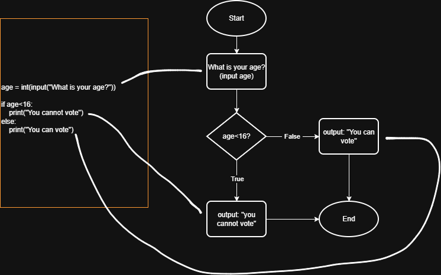

# Age Check example

A program asking for someone's age. If they are over 16 they are allowed to vote in the Scottish election.

### Input?
-> age
-> a number
-> integer

### Process:
< 16 -> no vote
>= 16 -> vote

### Output?
-> can vote
-> cannot vote

### Flowchart



### Pseudocode suggestions
```
Get input from user -> age

If age < 16 then output "You cannot vote"
Else output "you can vote"
```
